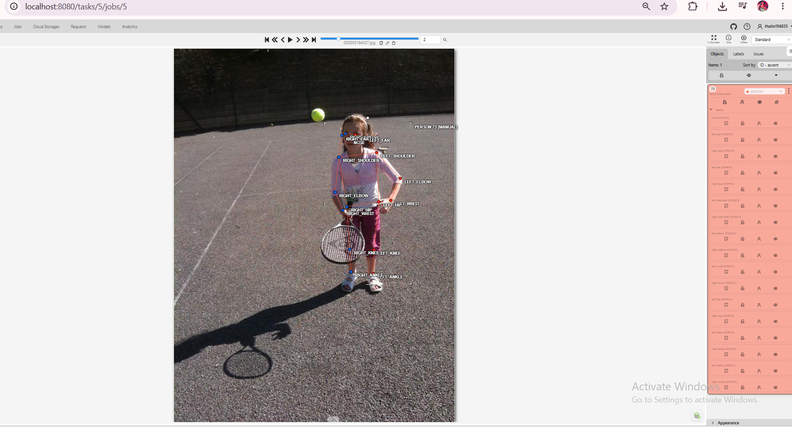
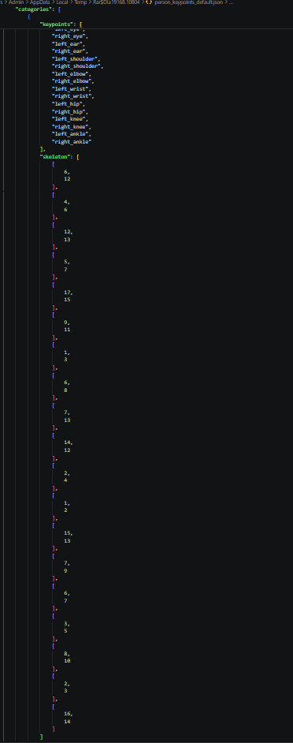

# Báo cáo cá nhân — HoVaTen-MSSV

Đổi tên file theo quy tắc `MSSV_HoTen.md`. Ví dụ: `20241234_NguyenVanAn.md`.

Dữ liệu: 12 ảnh người COCO val2017 (Lin et al., 2014) và 8 ảnh chân dung Wikimedia Commons, chỉ dùng trong lớp.

## 0. Thông tin học viên

- Họ tên: Trần Như Thái
- MSSV:2A202603184
- Email:sonhuongthai@gmail.com      
- Link repository:https://github.com/TranNhuThai20194835/K5-L2A-Day4-TranNhuThai-2A202603184-KeypointPose.git
- Phiên bản CVAT (Help → About):
- Máy: hệ điều hành Window · RAM 8 GB · chạy CVAT chế độ đầy đủ 
- Bộ ảnh (`src/exports/assignment.json` do `lab.py setup` tạo): có 
- Giờ bắt đầu:17h00
- Giờ kết thúc:23h20

## 1. Kiểm tra label (CP0)

| Label | Kiểu | Số điểm | Tên điểm đúng bảng của lab? | Đúng thứ tự? | Số cạnh |
|---|---|---:|---|---|---:|
| `person` |skeleton | 17 |có |có |19 |
| `face` |skeleton | 13 |có |có |13 |

Mẫu `person` dựng theo người quay mặt về camera (các điểm `left_*` nằm bên phải khung mẫu)? Có

Cách đổi cờ `occluded` / `outside` cho **một điểm** trên phiên bản CVAT này (một câu):
Mở rộng skeleton trong danh sách đối tượng bên phải, chọn đúng điểm con rồi bấm biểu tượng Occluded hoặc Outside của điểm đó


## 2. Số lượng đã gán và thời gian (CP1, CP2)

| Nhóm ảnh | Số ảnh | Số skeleton đã gán | Số người dưới 60 px (không gán) | Số poster / gương / màn hình bỏ qua | Thời gian (phút) |
|---|---:|---:|---:|---:|---:|
| `easy` | 5 | 5  | 0 | 0 | 20 |
| `occluded` | 3 | 6 | 0 | 0 | 15 |
| `back` | 2 | 3 | 0 | 0 | 10 |
| `small` | 1 | 4 | 0 | 0 | 10 |
| `crowd` | 1 | 3 | 6 | 0 | 20 |
| `faces` | 8 | 8 | — | 0 | 30 |

- Số ảnh người đã xong ở mốc phút 105: 7 / 10
- Thời gian thực tế (phút): CP1 40 · CP2 45 · CP3 30
- Ảnh tốn thời gian nhất là ảnh nào, vì sao?
là ảnh 000000572411 vì 4 người và rất nhỏ


## 3. Bảng ca khó (CP1, CP2)

Mỗi điểm bạn phân vân một dòng, nhất là phân vân giữa `v = 1` và `v = 0`, hoặc không chắc hướng người.

| Ảnh | Người / mặt | Điểm | Cờ đã chọn | Phân vân giữa | Lý do chọn |
|---|---|---|---:|---|---|
| 000000109010.jpg | #1, #2 | left_ankle, right_ankle | v = 0 | v = 1 / v = 0 | Điểm nằm ngoài khung ảnh (bị cắt ở mép dưới) nên là Outside, không phải Occluded |
| 000000272026.jpg | #3 | left_elbow | v = 0 | v = 1 / v = 0 | Khuỷu trái nằm ngoài mép phải ảnh (666, 364) |
| 000000292999.jpg | #1 | left/right_elbow | ___ | nên swap left/right_elbow hay giữ nguyên | tay bắt chéo |

## 4. Bảng tự review (CP3)

Đi từ ảnh cuối về ảnh đầu. 5 ảnh người (ít nhất 2 ảnh `back` hoặc `crowd`) và 3 ảnh mặt. Ít nhất 8 dòng, kể cả dòng `ok`. Ghi lỗi trước, sửa sau.

Mã lỗi dùng đúng một trong: `lr_swap`, `vis_flag`, `position`, `missing`, `extra`, `ok`.

| Ảnh | Người / mặt | Điểm | Mã lỗi | Ghi chú | Đã sửa? |
|---|---|---|---|---|---|
| 000000572411.jpg | #4 | toàn bộ | extra | Chỉ cao 27 px (< 60 px) | ___ |
| 000000359340.jpg | #1 (back) | right_wrist | vis_flag | Ngoài ảnh nhưng đánh Occluded, đổi sang Outside | Có |
| 000000307757.jpg | #2 (back) | knee, ankle | vis_flag | Điểm ngoài ảnh đánh Occluded, đổi sang Outside | Có |
| 000000272026.jpg | #3 (crowd) | left_elbow, left_knee, ankle | vis_flag | Điểm ngoài ảnh, đổi sang Outside | Có |
| 000000109010.jpg | #1 | left/right_ankle | vis_flag | Điểm ngoài ảnh, đổi sang Outside | Có |
| face_______ | #1 | ___ | ok | ___ | — |
| face_______ | #1 | ___ | ok | ___ | — |
| face_______ | #1 | ___ | ok | ___ | — |

Tổng hợp số lỗi theo mã:

| `lr_swap` | `vis_flag` | `position` | `missing` | `extra` | `ok` |
|---:|---:|---:|---:|---:|---:|
| 0 | 4 | 0 | 0 | 1 | 3 |

Điểm còn phân vân giữa `v = 1` và `v = 0` (ghi cả hai lựa chọn và lý do chọn):

left_ankle ở 000000109010.jpg, phân vân giữa v = 1 (Occluded) và v = 0 (Outside). Chọn v = 0 vì điểm nằm ngoài khung ảnh (124, 370), Occluded chỉ dành cho điểm còn trong ảnh nhưng bị che

## 5. Kiểm file xuất và kết quả tự kiểm (CP4)
Tự kiểm tay trong file JSON:

| File | Người / mặt kiểm (ảnh, thứ tự) | Số phần tử `keypoints` | Điểm `outside` ra `v = 0`, `occluded` ra `v = 1`? | `num_keypoints` khớp? |
|---|---|---:|---|---|
| `TranNhuThai_persons.zip` | 000000109010.jpg, người #1 | 51 | Có: left_ankle, right_ankle (outside) ra v = 0, ảnh cao 363 px nên cả hai nằm ngoài; left_ear và left_wrist (occluded) ra v = 1,  | Khớp: 15 |
| `TranNhuThai_persons.zip` | 000000359340.jpg, người #1 | 51 | Có: right_wrist (outside) ra v = 0; điểm left_eye (occluded) ra v = 1 | Khớp: 14 |
| `TranNhuThai_faces.zip` | face_469647.jpg, mặt #1 | 39 | Có: right_eye_outer (occluded) ra v = 1 | Khớp: 13 |

Sau khi xuất, CVAT ghi `occluded` thành `v = 1` và `outside` thành `v = 0`. Tọa độ của điểm `outside` trong file là tọa độ cũ (không phải `0, 0`): CVAT 2.x xuất như vậy, điểm v = 0 vẫn bị bỏ qua khi huấn luyện và chấm.

Hai job đã chuyển sang completed trên CVAT?: Có 

Dán phần **TÓM TẮT** in ra từ `src/check_submission.py`:

```text
TÓM TẮT (dán vào báo cáo mục 5) -----
- File person: TranNhuThai_persons.zip
  Số ảnh: 12 · số skeleton `person`: 21 · mỗi annotation 51 số
  Skeleton theo ảnh: 000000091637=2, 000000109010=2, 000000194027=1, 000000272026=3, 000000292999=1, 000000294379=1, 000000307757=2, 000000314154=1, 000000324953=2, 000000359340=1, 000000455536=1, 000000572411=4
  Cờ v: v=2 245 (69%) · v=1 69 (19%) · v=0 43 (12%)
  num_keypoints trung bình: 15.0
- File face: TranNhuThai_faces.zip
  Số ảnh: 8 · số skeleton `face`: 8 · mỗi annotation 39 số
  Skeleton theo ảnh: face_155465=1, face_185015=1, face_196742=1, face_294580=1, face_425647=1, face_442231=1, face_469647=1, face_560526=1
  Cờ v: v=2 87 (84%) · v=1 1 (1%) · v=0 16 (15%)
  num_keypoints trung bình: 11.0
- Ghi chú: 59 điểm v = 0 vẫn mang tọa độ cũ (CVAT 2.x xuất như vậy; chuẩn COCO ghi 0, 0). Không phải lỗi: điểm v = 0 bị bỏ qua khi huấn luyện và khi chấm.
- Số [LỖI]: 0 · số [CẢNH BÁO]: 3
Kết quả: ĐẠT (đọc lại từng cảnh báo ở trên)
```

Các `[CẢNH BÁO]` còn giữ nguyên và lý do:
- [CẢNH BÁO] 000000292999.jpg #1: cặp elbow nằm ngược phía so với các cặp còn lại. Có thể đổi trái/phải một cặp (lr_swap), hoặc tay / chân bắt chéo thật: kiểm lại.
- [CẢNH BÁO] 000000572411.jpg #4: các điểm chỉ trải cao 27 px (< 60 px). Người dưới 60 px không gán; nếu người cao hơn nhưng bị cắt khung thì bỏ qua cảnh báo này.
- [CẢNH BÁO] 000000572411.jpg #4: cặp wrist nằm ngược phía so với các cặp còn lại. Có thể đổi trái/phải một cặp (lr_swap), hoặc tay / chân bắt chéo thật: kiểm lại.

## 6. Ảnh chụp màn hình

1. Label `person` trong label constructor (đủ 17 điểm có tên):

   

2. Một người quay lưng đã gán, cờ đã đặt:

   

3. Một khuôn mặt đã gán 13 điểm, phóng to vùng mắt:

   

4. Một đoạn JSON xuất của một người:

   

Nguồn ảnh: COCO val2017 / Wikimedia Commons.

## 7. Tự đánh giá

1. Lỗi bạn mắc nhiều nhất hôm nay, và cách bạn sẽ tránh ở dự án thật:

   Lỗi nhiều nhất là đánh dấu nhầm các điểm nằm ngoài khung ảnh (chủ yếu mắt cá chân và đầu gối của người bị cắt ở mép dưới ảnh) thành Occluded (v = 1) thay vì Outside (v = 0). Lần xuất đầu tiên có 22 lỗi, tất cả đều thuộc loại này. Nguyên nhân là tôi coi "không nhìn thấy" và "bị che" là một, trong khi Occluded chỉ dành cho điểm vẫn nằm trong ảnh nhưng bị vật khác che, còn điểm nằm ngoài khung phải là Outside.
   Cách tránh: trước khi gán trạng thái, tự hỏi "điểm này có nằm trong khung ảnh không?"; nếu không thì Outside, nếu có mà bị che thì Occluded; với ảnh người bị cắt ở mép, kiểm tra các điểm chân/tay trước tiên; chạy script kiểm tra (check_submission.py) sau mỗi vài ảnh thay vì đợi đến cuối, để lỗi cùng loại không lặp lại hàng loạt.

2. Một quy tắc bạn đề xuất thêm vào guideline (kèm ảnh ví dụ nếu có):

   Với mỗi điểm không nhìn thấy, hỏi theo thứ tự: 
   (1) Điểm có nằm ngoài khung ảnh không? Nếu có, đánh Outside (v = 0). 
   (2) Nếu nằm trong khung nhưng bị che: đoán chắc được vị trí (từ dáng người, đối xứng) thì Occluded (v = 1); không đoán chắc thì Outside (v = 0). Không điền điểm đoán bừa chỉ để đủ 17 điểm.

3. Nhãn của bạn đi vào model ở đâu? Chọn một lỗi bạn đã sửa và nói nó sẽ làm model học sai thế nào (heatmap, trọng số trong loss, hay bước lật ảnh):

   Lỗi chọn: điểm ngoài ảnh bị đánh v = 1 thay vì v = 0 (ví dụ left_ankle ở 000000109010.jpg).
   Trong huấn luyện, các điểm có v > 0 được dùng để sinh heatmap đích (một đỉnh Gaussian tại tọa độ điểm) và được tính vào loss; điểm v = 0 bị bỏ qua khỏi loss. Nếu điểm ngoài ảnh bị gắn v = 1, tọa độ của nó nằm ngoài (hoặc sát mép) khung ảnh, nên model bị ép dự đoán một đỉnh heatmap ở nơi không có chi tiết hình ảnh nào để dựa vào. Loss ở điểm này luôn lớn và nhiễu, kéo trọng số học cách "đoán bừa" mắt cá chân ở mép ảnh, làm giảm độ chính xác cho cả những ca bình thường. Ngoài ra, v = 1 còn có thể được tính vào num_keypoints và vào việc chấm OKS, nên bị tính sai khi đánh giá.
   Với bước lật ảnh (flip augmentation), nhãn trái/phải được hoán đổi theo cặp; nếu trạng thái v sai thì điểm sai này bị nhân lên ở cả ảnh gốc lẫn ảnh lật.

## 8. Khó khăn và lỗi kỹ thuật

...

## Bonus (nếu làm)

### B1 — 3 ảnh người khó thêm

| Ảnh | Số skeleton | Số người dưới 60 px | Ca khó nhất |
|---|---:|---:|---|
| | | | |
| | | | |
| | | | |

Kết quả `src/check_submission.py` cho `HoVaTen_bonus_persons.zip`:

```text
(dán ở đây)
```

### B2 — 5 ảnh khuôn mặt đen trắng / hồng ngoại

Ảnh không màu khó hơn ở điểm nào? Kính râm trên ảnh hồng ngoại có còn là `v = 1` không?

...

### B3 — Model so với nhãn của tôi (không tính điểm)

- Demo đã dùng:
- Ảnh đã thử:

1. Model có trả điểm cho khớp bị che, hay khớp ngoài ảnh không? Confidence ở các điểm đó thế nào?

   ...

2. Với người quay lưng, model có đổi trái/phải không?

   ...

3. Bộ điểm của model có giống 17 điểm COCO không?

   ...

## 9. Tài liệu tham khảo và công cụ AI đã dùng

...
